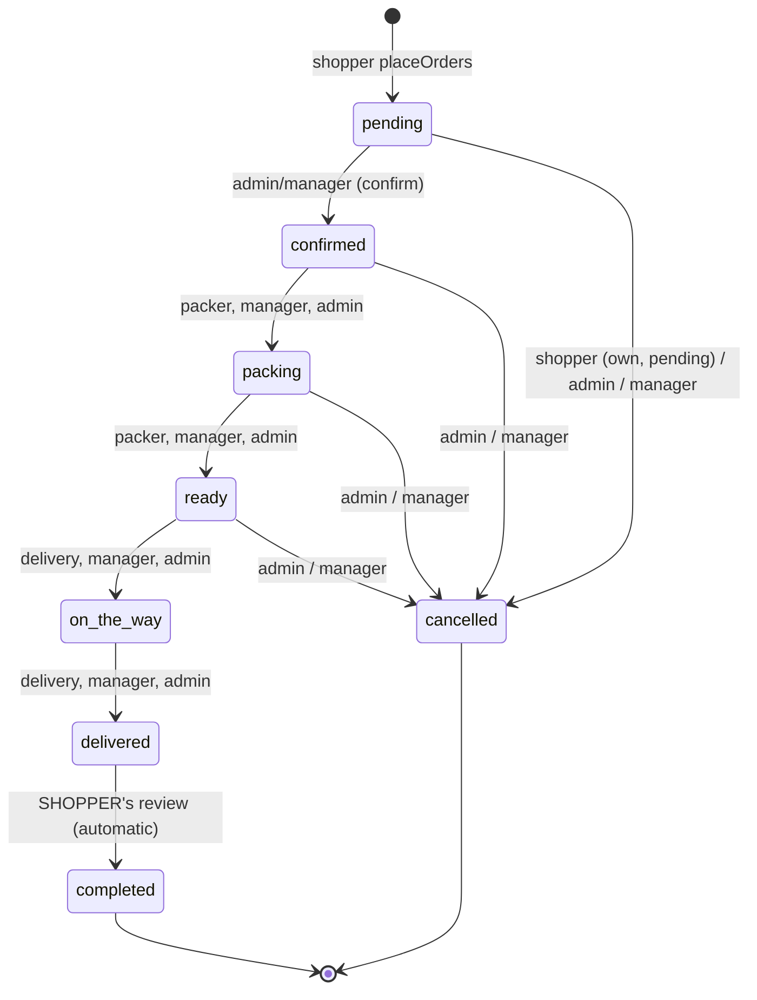
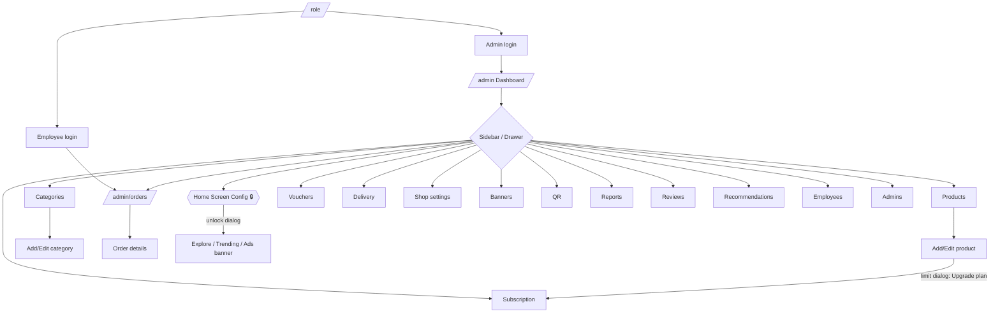

# ADMIN_FLOW.md — Admin / Employee application guide

Written from the source code of this repository (companion to `SHOPPER_FLOW.md`).
Names of classes, methods, routes, collections and fields are real. Where the code
does not confirm something it says so. Status legend: ✅ implemented · ◐ partial · ✖ not implemented.

---

## 0. Read this first — how this project differs from the brief

| The brief assumes | What the code actually does |
|---|---|
| `Provider` + `ChangeNotifier`, Services, API classes, **Dio** | **No Provider and no Dio.** State = `flutter_bloc` Cubits (`AuthCubit`, `CartCubit`, `WishlistCubit`, `LocaleCubit`) + screen-local state + Firestore `Stream`s. The one `ChangeNotifier` is `AuthSession` (read by the router). Plus two small singletons for the storefront lock (`StorefrontAccess`, `StorefrontLockController`) and `AdminCompanyName`. |
| REST endpoints, base URL, auth headers | **No REST API / no base URL / no HTTP headers.** Backend = Firebase: Firestore, Firebase Auth (email+password for staff), Cloud Messaging, Remote Config, Cloud Functions, Realtime Database (mirror writes). The "API" is the `AppRepository` interface (`lib/core/repositories/app_repository.dart`) reached via the global getter `repo`. |
| Image upload | **No file upload.** There is no `firebase_storage`/`image_picker`; images are **URLs typed/pasted** (product, category, banners, logo). |
| Content / Guides / Articles modules | **Not implemented.** Nothing in `lib/` references guides or articles. |
| Customers, Service requests, Digital warranty modules | **Not implemented** (no admin customer list; no service-request or warranty code). |
| Special deals | Implemented as **Vouchers** (+ the home "Store Vouchers & Deals" rail on the shopper side). |
| Shipment / payment config, branches | Delivery is configured as **pincode charges** + shop delivery types; payment is recorded per order. **No branch management.** |
| Order notifications | Written by Cloud Functions, but see the trigger-path caveat in §12. |

---

## 1. Project architecture

### 1.1 Layers and how they talk

```mermaid
flowchart LR
  UI[Admin screens\nlib/features/admin/*] -->|read context.read<AuthCubit>| AC[AuthCubit / AuthSession]
  UI -->|repo.xxx()| R[AppRepository interface]
  R --> FR[FirebaseAppRepository]
  R --> MR[MockAppRepository - tests/offline]
  FR --> FS[(Cloud Firestore)]
  FR --> AU[Firebase Auth]
  FR --> RT[(Realtime DB mirror)]
  FS -->|triggers| CF[Cloud Functions]
  CF --> FCM[FCM + notifications docs]
  UI --> DOM[core/domain rules\nOrderStatusRules, validators, EmployeeRole ...]
  R --> M[core/models fromMap/toMap]
```

`UI → (local state / Cubit) → repo → Firestore → Model.fromMap → Stream/Future → UI`.
There is no Service layer between screens and the repository except small focused helpers
(`ReportService` for exports, `QrDeepLinkService`, `EmailService`, `AdminCompanyName`).

### 1.2 Folder map

```
lib/
  main.dart, main_uat.dart, main_prod.dart        entry + flavours
  app/  app.dart · routes/app_router.dart · theme/ · l10n/ · widgets/
  core/ config/ models/ repositories/ database/ domain/ services/ cache/ utils/ widgets/
  features/
    admin/            admin_shell.dart  + dashboard, orders, products, categories, vouchers,
                      employees, admins, delivery_charges, banners, shop, reviews,
                      recommendations, reports, qr, home_config, storefront_lock, subscription
    employee/         employee_access_scope.dart, order_queue/, packing/
    auth/             auth_cubit.dart, admin_login/, employee_login/, signup/admin_signup_screen.dart
    company_onboarding/  company_onboarding_screen.dart  (create a shop + first admin)
functions/            Cloud Functions (index.js, product_limits.js)
firestore.rules       security rules   ·   firestore_rules_test/  emulator tests (.mjs)
```

### 1.3 Patterns
- **Repository + service locator** (`ServiceLocator.instance.init`) – `repo`, `connectivity`, `deepLinks`, `reports` getters.
- **Pure domain classes** hold rules so UI, repo and rules agree: `OrderStatusRules`, `OrderPermissions`,
  `EmployeeRole/EmployeeAccess`, `ProductValidator/CategoryValidator/VoucherValidator`,
  `ProductLimits`, `SubscriptionPlan`, `PackingWorkflow`, `CategoryTree`.
- **Admin pages are `GoRoute`s of type `AdminRoute`** (no transition animation) that each wrap their body in
  `AdminShell` (sidebar/app bar) – or `LockedAdminShell` for password-protected pages.
- **Shop scoping**: every admin screen reads `AuthSession.currentUser?.companyId` and passes it to `repo`;
  Firestore paths are `companies/{companyId}/…`. An admin only ever manages their own shop.

### 1.4 Localisation, theme, responsive
- ARB files `lib/app/l10n/app_{en,hi,gu}.arb` (`flutter gen-l10n`; `l10n.yaml`). `AppLocalizations.of(context).key`;
  non-widget code uses `L10n.current.key`. Many admin strings are still hard-coded English (e.g. toasts in
  `admin_orders_screen.dart`, `admin_ads_banners_screen.dart`, sidebar section titles `MAIN`, `CATALOG & SALES`…).
- Theme: `AppTheme` (`app/theme/app_theme.dart`) with admin-specific helpers `adminSidebarBackground`,
  `adminSidebarBorder`, `adminActiveNavBackground`, `adminHoverNavBackground`.
- Responsive: `kAdminDesktopBreakpoint = 1024` (`admin_shell.dart`): **> 1024 px = persistent sidebar + framed content
  (`_AdminDesktopSidebar`, `_AdminDesktopAppBar`, `_AdminDesktopContentFrame`)**; narrower = classic `AppBar` + `Drawer`
  (`_AdminMobileDrawerContent`). `ResponsiveContext` (`context.isDesktop` …) is used inside screens.

---

## 2. Initialisation and login

### 2.1 Start-up
Same as the shopper app (`lib/main.dart`): `Firebase.initializeApp(EnvironmentConfig.firebaseOptions)` (UAT/PROD via
`main_uat.dart` / `main_prod.dart`), App Check (not on web), FCM background handler, `ServiceLocator.init`,
Remote Config, cache setup, then `Bootstrap` creates the cubits and `App` builds `MaterialApp.router(appRouter)`.
There is **no API base URL** – the environment only selects Firebase options and the public domain
(`EnvironmentConfig.publicDomain`). Local storage: `SharedPreferences` (language, cart, packing ticks),
`SecureSessionCache` (encrypted cached `AppUser`), `FlutterSecureStorage`.

### 2.2 Entry to the admin area
`SplashScreen` → `RoleSelectionScreen` (`/role`) → **Admin login** (`/admin-login`), **Employee login**
(`/employee-login`) or **Register a shop** (`/company-onboarding`).

### 2.3 Admin login (`AdminLoginScreen` → `AuthCubit.adminLogin` → `FirebaseAppRepository.adminLogin`)
Inputs: **company name, company password, admin email, admin password**.
1. `FirebaseAuth.signInWithEmailAndPassword(email, password)`.
2. Resolve the company document: `companies` where `name == companyName`, else `slug == slugified name`, else lower-case
   name; among several matches the one whose `companyPassword` verifies wins.
3. Find the admin profile: `companies/{id}/admins/{uid}` → collectionGroup `admins` where `id == uid` → legacy flat
   `admins/{uid}` (or by email). Missing → exception "no admin profile".
4. **Company password check**: `CompanyPassword.verify(typed, stored)` (PBKDF2-HMAC-SHA256 hash or legacy plain text).
   A plain-text password is silently **upgraded to a salted hash** after a successful login.
5. Company/name association check; legacy admin docs are **auto-migrated** into `companies/{id}/admins/{uid}`.
6. Writes pointer `users/{uid} {role:'admin', companyId, name, email}`; returns `AppUser(role:'admin')`.
7. `AuthCubit` calls `AuthSession.set(user)`, saves the encrypted cache, registers the push token.
Errors are mapped from `FirebaseAuthException` codes (`invalid-credential`, `user-disabled`, `too-many-requests`) to localised messages.

### 2.4 Employee login (`EmployeeLoginScreen` → `AuthCubit.employeeLogin`)
Inputs: company name, email, password (no company password). Same lookup pattern against `employees`; writes
`users/{uid} {role:'employee', companyId}` and returns an `AppUser` with `permissions`. Lands on `employeeHomeFor(user)` = **`/admin/orders`**.

### 2.5 Register a shop / add an admin
- `CompanyOnboardingScreen` (wizard: basic details, weekly hours, delivery types, currency, **tenant password**, logo URL)
  creates the company, creates the admin Firebase Auth user + `admins` docs + `users/{uid}`, saves the logo to `media_links`,
  calls `AuthCubit.setAuthenticatedUser` and `go(/admin)`. (Repository helpers `createCompany`, `createAdminAccount`.)
- Add another admin: Admins screen → "add" → `/admin-signup?companyId=&companyName=` → `AdminSignupScreen`.

### 2.6 Session, logout, restrictions
- **Restore**: `AuthCubit._restoreSession()` (encrypted cache first, then Firebase Auth). `AuthSession.isRestoring` makes the router wait.
- **Logout**: `AuthCubit.signOut()` — first `StorefrontAccess.lock()` (relocks the home-screen config), then `repo.signOut()`,
  clears the cache, `AuthSession.set(null)`.
- **Route guard** `appRouteRedirect`: `/admin` and `/admin/*` need `AuthSession.isAdmin`; an employee may open only
  `/admin/orders` (+ `/admin/orders/:id`) and the read-only `/admin/employees` list, anything else under `/admin` redirects to
  `/admin/orders`; a non-staff visitor is sent to `/role`. After boot, an admin is always taken to `/admin`.
- **Security/lockout**: no app-side attempt counter; only Firebase's own `too-many-requests`. **Shop "shift gating"**:
  the employee form has a `shiftActive` field; no login-time enforcement was found in the repository code (◐).

---

## 3. Admin modules

Navigation entries come from `_allAdminNavItems` in `admin_shell.dart`. Employees see only **Orders Pipeline** and **Employees** (`_getAdminNavItems`).

| Group | Item | Route | Screen |
|---|---|---|---|
| MAIN | Dashboard | `/admin` | `AdminDashboardScreen` |
| MAIN | Orders Pipeline | `/admin/orders` (+`/:id`) | `AdminOrdersScreen`, `AdminOrderDetailsScreen` |
| CATALOG & SALES | Products | `/admin/products` (+`/add`, `/edit/:id`) | `AdminProductsScreen`, `AdminAddProductScreen` |
| | Categories | `/admin/categories` (+`/add`, `/edit/:id`) | `AdminCategoriesScreen`, `AdminAddCategoryScreen` |
| | Vouchers | `/admin/vouchers` | `AdminVouchersScreen` |
| | Delivery Charges | `/admin/delivery-charges` (+`/add`, `/edit/:pincode`) | `AdminDeliveryChargesScreen`, `AdminAddDeliveryChargeScreen` |
| STOREFRONT CONFIG | Shop Settings | `/admin/shop-settings` | `AdminShopSettingsScreen` |
| | Banners (offer banners) | `/admin/banners` | `AdminBannersScreen` |
| | QR Codes | `/admin/qr` | `AdminQrScreen` |
| HOME SCREEN CONFIG 🔒 | Home Explore Categories | `/admin/home-explore-categories` | `AdminExploreCategoriesScreen` |
| | Home Trending Now | `/admin/home-trending-now` | `AdminTrendingNowScreen` |
| | Home Screen Ads Banner | `/admin/home-ads-banners` | `AdminAdsBannersScreen` |
| OPERATIONS & DATA | Reports | `/admin/reports` | `AdminReportsScreen` |
| | Reviews | `/admin/reviews` | `AdminReviewsScreen` |
| | Recommendations | `/admin/recommendations` | `AdminRecommendationsScreen` |
| | Employees | `/admin/employees` (+`/add`, `/edit/:id`) | `AdminEmployeesScreen`, `AdminAddEmployeeScreen` |
| | Admins | `/admin/admins` | `AdminAdminsScreen` |
| | Subscription Plan | `/admin/subscription` | `AdminSubscriptionScreen` |

Employee-only extra screens: `/employee` → `EmployeeOrderQueueScreen`, `/employee/packing/:orderId` → `PackingScreen` (see §4.5).

For every module below the "API" is `repo.<method>`; Firestore paths are under `companies/{companyId}` unless stated.

### 3.1 Dashboard ✅ — `features/admin/dashboard/admin_dashboard_screen.dart`
Three nested streams: `repo.orders(companyId:)`, `repo.products(companyId:, includeUnpublished: true)`, `repo.reviews(companyId)`.
`_DashboardBody` computes **client-side**: today's orders (by `createdAt` within the business day), pending count, today's revenue,
store rating/review count, an order-pipeline board (pending/confirmed columns) with inline confirm via `repo.updateOrderStatus`, recent
orders, and a "Store Modules" grid (15 module cards linking to the routes above, with product count badge). App bar also offers a shop QR
dialog. States: shimmer while loading, empty-state cards. No pagination.

### 3.2 Shop management (single shop, no listing/branches) ◐
- **Shop Settings** (`admin_shop_settings_screen.dart`): `repo.company(id)` → edit → `repo.updateCompanyDetails(draft)` which writes only
  `Company.toEditableMap()` (description, address, phone, maps link, images, weekly opening hours via `WeeklyHours`, delivery types
  `self_pickup`/`home_delivery`, handling & delivery minutes, `minOrderAmount`). **Never** written here: name (it is the login), password, status, ratings.
  Time pickers `_pickTime`; mirrors to Realtime DB best-effort.
- **Company model** fields of note: `status` (active|suspended|inactive), `isVerified`, `maxProducts`, `plan`.
- ✖ No shop *listing*, no multi-shop admin, no branches. ✖ No "shipment/payment gateway" configuration (delivery = pincode charges, §3.9).

### 3.3 Product management ✅ — `products/admin_products_screen.dart`, `admin_add_product_screen.dart` (3.8k lines)
- **List**: stream `repo.products(companyId, includeUnpublished: true)`; search + sort via `Catalog.apply(CatalogQuery)`; chips: All / In stock /
  Low stock / Sold out (`Catalog.stockStatus`), **Published / Unpublished**, Multi-image, Missing images; tile shows category, price (MRP
  struck through when discounted), low-stock flag, `_UnpublishedBadge`; actions copy id, edit, QR (`showEntityQrDialog`), delete (confirm →
  `repo.deleteProduct`, which also removes it from categories). Image-audit dialog counts products with/without images.
- **Add/Edit form** (`AdminAddProductScreen`): name, type (`weight_based`/`quantity_based`), unit/unitType, **MRP (`amount`)**, **selling price
  (`discountAmt`)**, SKU, colour, stock (`stockQty` / `isUnlimitedStock`), category, images (URLs), **variants** (`ProductVariant`: sku, title,
  attributes, price/MRP override, stock, unit), options, **add-ons** (`widgets/addons_editor.dart`, `AddOnRules`), specifications, highlights and
  detail sections (`widgets/structured_content_editors.dart`), policy text, `isRecommended`, **Published switch** (`product-published-switch`).
- Save → `repo.saveProduct(product)` (keeps category assignment in sync, enforces plan limits – §3.12).
- Validation: `ProductValidator` (name ≥2 chars, MRP > 0, selling price ≥ 0 and < MRP, stock ≥ 0 unless unlimited, unit > 0, weight-based needs unit type) + form validators.
- Out-of-stock: stock 0 shows "Sold out"; shopper cannot add beyond `maxQty`; unpublished products are hidden from shoppers.
- ✖ No image upload; ✖ no product "guides/articles".
- Product link/QR: `EntityQrDialog` / `QrDeepLinkService.buildProductUrl(shopId, productId)` (same URL as the shopper share button).

### 3.4 Category management ✅ — `categories/*`
- **List** (`AdminCategoriesScreen`): collapsible tree built by `CategoryTree` (repairs cycles/missing parents), counts include descendants, **drag to reorder siblings** →
  `repo.reorderCategories(orderedSiblings)` (batch write of `sortOrder` 0..n, only changed docs), delete explains re-parenting → `repo.deleteCategory`.
- **Add/Edit** (`AdminAddCategoryScreen`): name (unique per company, case-insensitive – `CategoryValidator`), type, parent (cycle-blocked), icon (URL/emoji,
  default 🛍️), and **dual-panel `ProductAssignmentPicker`** (swipe or +/– to assign; drag handle sets in-category order; nothing is written until Save) →
  `repo.saveCategory(category)`.
- Relationship: `Category.productList` ↔ `Product.categoryId`; `backfillCategorySortOrder` is a one-time maintenance method.
- Home category config: see §3.10 (Explore Categories).

### 3.5 Order management ✅ — see §4 (full workflow). Files: `orders/admin_orders_screen.dart`, `admin_order_details_screen.dart`,
`widgets/{order_items_dialog,order_team_card,payment_verification_dialog}.dart`.
List: search (`order-search-field`: reference, customer name/phone/email, pincode, address, user id, item names) + status filter chips
(`OrderStatusRules.boardColumns` with counts). Details: items (`repo` order + `items` subcollection), customer, address/pickup card, payment,
status history, team assignment, review summary.

### 3.6 Employee & role management ✅ — `employees/*`, `core/domain/employee_roles.dart`
- Only an **admin** adds/edits/deletes employees; employees see the list read-only (`/admin/employees`).
- Form (`AdminAddEmployeeScreen`): name, email, password (required on create), role (`EmployeeRole`), gender, DOB, address, notes, salary + type, `shiftActive`.
- **Create**: `FirebaseAppRepository.createEmployeeAccount` creates the Firebase Auth user on a **secondary Firebase app** (so the admin stays signed in; falls back to a
  generated uid if that fails; "email already in use" is tolerated), then `saveEmployee` writes `companies/{id}/employees/{uid}`, `users/{uid} {role:'employee', companyId}`
  and a Realtime-DB mirror. **Delete** removes the employee doc(s) and `users/{id}` (the Auth account itself is not deleted by the app).
- **Roles → permissions** (`EmployeeRole.fullPermissions`):

| Role (`id`) | `canPack` | `canDispatch` | `canManageOrders` | Order access |
|---|---|---|---|---|
| Manager (`manager`) | ✔ | ✔ | ✔ | every status; cancel (not "completed") |
| Order Packer (`order_packer`) | ✔ | – | – | confirmed→packing→ready |
| Order Delivery (`order_delivery`) | – | ✔ | – | ready→on_the_way→delivered |

  Legacy profiles with free-text roles resolve via saved permissions (never promoted to manager); an empty permission map keeps packing access (`EmployeeAccess._has`).
  The app **and** `firestore.rules` check permissions, not titles. `LiveEmployeeAccess` rebuilds with the employee's *current* permissions from `repo.employees`.
- Admins list (`AdminAdminsScreen`): `repo.admins(companyId)`; add → `/admin-signup`.

### 3.7 Content management (guides, articles, content categories) ✖
Not present in this codebase. (`Product` has `details`, `allDetails` (structured sections), `policy` — product-level content only.)

### 3.8 Review management ✅ — `reviews/admin_reviews_screen.dart`
Streams `repo.reviews`, `repo.orders`, `repo.products`; a `_JoinedReview` joins each review with its order (customer phone/details – only staff can read orders) and product. Shows
rating, comment, customer, order, product, date; filter/search in-screen; `_toggleVisible` → `repo.setReviewVisibility(id, visible, companyId:)` (hide/show on shopper pages).
Admins cannot edit or delete review text. Shop rating shown on the dashboard.

### 3.9 Delivery charges ✅ — `delivery_charges/*`
Pincode → charge: list (`repo.deliveryCharges(companyId)`), add/edit (`repo.saveDeliveryCharge`), delete (confirm), **bulk CSV import** (`repo.importDeliveryCharges`). Used by shopper checkout via `repo.deliveryCharge(pincode, companyId)`.

### 3.10 Storefront configuration ✅ (password-protected) — see §3.10.1
Pages: **Home Explore Categories** (`home_config/admin_explore_categories_screen.dart`, collection `home_explore_categories`: `shopId, categoryId, categoryName, isActive, displayOrder`),
**Home Trending Now** (`admin_trending_now_screen.dart`, `home_trending_now`: `itemType` product|category, `productId/categoryId`, `isActive`, `displayOrder`, reorder), **Home Screen Ads Banner**
(`banners/admin_ads_banners_screen.dart`, `home_ads_banners`: `image` (URL), `actionType` product|category|external_url|company_page, `actionTarget`, `priority`, `shopId`).
Shared: `ShopSelectorBar` for shop choice. Shopper effect: `HomeScreen` reads `repo.adBanners(shopId:)`, `homeExploreCategories`, `homeTrendingNow`; a tap on an ads banner follows its action.
Firestore rules: create/update/delete need `isCompanyAdmin(shopId)`; explore/trending also validate fields (`isValidHomeExploreCategory/TrendingItem`).

#### 3.10.1 Lock / unlock flow
- Pages are wrapped in `LockedAdminShell`; sidebar group "HOME SCREEN CONFIG" has a lock icon (`_ProtectedGroupHeader`), app bars show the lock button (`storefront-lock-button`).
- State: `StorefrontAccess` (static) holds one `StorefrontLockController`; **one unlock opens all three pages**. It binds to `AuthSession` and locks whenever the user id
  changes or becomes null. **No auto-lock on navigation**; it locks on (a) **logout** (`AuthCubit.signOut`), (b) **manual lock** via lock icon → confirmation dialog
  (`confirmAndLock`). The state is **never persisted**; after login it starts locked.
- Unlock dialog (`StorefrontUnlockDialog`): password compared against the value from `repo.storefrontLockHash()` which reads Firestore **`home_screen_confing_password/password`**
  (field `password`, fallback `passwordHash`; always from the server). `CompanyPassword.verify` accepts a plain value or a `pbkdf2-sha256$iter$salt$hash` string
  (`tool/storefront_password_hash.dart` generates one). The password is set by the developer in the Firebase console (rules: read = signed-in, write = false).
- Locked + direct URL: page renders with a locked overlay (`storefront-locked-overlay`) and editing buttons do nothing.
- ⚠ Any signed-in user can read that document (rules comment explains why) – store a hash, not plain text.

### 3.11 Reports ✅ — `reports/admin_reports_screen.dart`, `core/services/report_service.dart`
Date presets (7) + custom range (`ReportDatePreset`, `report_date_range.dart`), live KPIs from `repo.orders(companyId)`, exports: **Excel (.xlsx), CSV, PDF** (`ReportService.buildOrdersReportPdf`, `saveFileCrossPlatform`),
catalog Word doc builder exists (`buildCatalogDoc`). Computation is client-side.

### 3.12 Subscription & plans ✅ — `subscription/admin_subscription_screen.dart`, `core/domain/subscription_plans.dart`, `product_limits.dart`
- Plans (`SubscriptionPlan`): **Basic** 50 products / 4 categories, **Golden** 80 / 5, **Diamond** 120 / 7. Contact for upgrades: `PlanContact` (Ayush Patel, work.ayushkumar112428@gmail.com) via a `mailto:` (`launcher` override for tests; falls back to showing the address).
- `Company.maxProducts = plan?.maxProducts ?? max_products`; `plan` overrides `max_products`. **Set in the Firebase console** (rules forbid shop admins changing `plan`/`max_products`).
  Current plan shown = `company.plan ?? SubscriptionPlan.matchingMaxProducts(maxProducts)` else "Custom plan".
- Limits (`ProductLimits`): `publishLimit = max`; `totalCap = max + (max*20)~/100` (the extra 20% may only be **unpublished**). `decide()` → `allowed / publishBlocked / createBlocked`.
- Where enforced: (1) UI `AdminAddProductScreen._checkPlanLimits` + `showPlanLimitDialog` (Cancel / Upgrade plan / Save as unpublished) → "Upgrade plan" opens `/admin/subscription`;
  (2) repository `saveProduct` guard (`ProductLimitException`; publish over limit is stored unpublished); (3) Cloud Function `enforceProductLimits` (transaction; deletes a new product
  over the total cap, unpublishes one over the publish limit); (4) rules block changes to `plan`/`max_products`.
  Counting uses `repo.productCounts(companyId)` (Firestore `count()` aggregates).
- **Category limits (4/5/7) are displayed only – not enforced anywhere.**

### 3.13 Other modules
- **Vouchers (special deals)** ✅ `vouchers/admin_vouchers_screen.dart`: scoped to the shop; search + filter (all/active/paused/expired); create/edit/pause (`repo.saveVoucher`), delete with confirm (`repo.deleteVoucher`); live redemption counters.
  `VoucherValidator`: code 3–24 chars `[A-Z0-9]`, unique per store; percentage 0–100 / fixed > 0; min order ≥ 0 (and > discount for fixed); per-user limit ≥ 1; total uses ≥ 1 and ≥ per-user; expiry not in the past; scope all / specific product / specific category (needs ids).
- **Offer banners** ✅ `banners/admin_banners_screen.dart` (`repo.offerBanners`, `saveBanner`, `deleteBanner`) – 16:9 graphic URL + action target.
- **Recommendations** ✅ `recommendations/admin_recommendations_screen.dart` (`recommendationRecords`, `saveRecommendation`): pin a product, else best-seller fallback.
- **QR codes** ✅ `qr/admin_qr_screen.dart`, `widgets/entity_qr_dialog.dart`: QR + shareable URL for shop / category / product (`QrDeepLinkService`: `buildShopUrl/CategoryUrl/ProductUrl`, scheme variants), PNG download/share.
- **Notifications** ◐ stored by Cloud Functions; staff get an FCM topic message `company_<id>` on new order (`onOrderCreated`); no admin notification screen/handler in the app.
- **Customers** ✖ no admin customer management. **Service requests / digital warranty** ✖.
- **Settings** ◐ only Shop Settings (above) and language selector.

---

## 4. Order workflow (Shopper → Admin → completion)



1. **Creation (shopper)**: `repo.placeOrders` batch-writes `companies/{id}/orders/{orderId}` (+ `items/*`) with `orderStatus:'pending'`, `paymentStatus:'pending'`, `statusHistory:[{pending,'Order placed'}]`. (See `SHOPPER_FLOW.md` §4.)
2. **Reception**: admin screens subscribe with `repo.orders(companyId: id)` – a live stream, so new orders appear instantly. Employees use the same stream on `/admin/orders`.
3. **List**: `AdminOrdersScreen` – search + `_StatusFilterBar` chips for every `OrderStatusRules.boardColumns` status with counts; each card shows status badge (`OrderStatusBadge`/`orderStatusLabel`), items summary, customer, payment state and a **review summary** ("Waiting for customer review" or the stars) via `repo.orderReviews`.
4. **Details**: `/admin/orders/:id` → `AdminOrderDetailsScreen` (items dialog, address or pickup card, status timeline from `statusHistory`, payment verification, team card).
5. **Buttons are computed from `OrderPermissions`** (`AuthSession.orderPermissions`): admin = full; employee = `OrderPermissions.employee(access)`. `canMove(from,to)` is false for `to == 'completed'` (never a button). `canCancel` and `canVerifyPayment` are admin/manager only.
   The visible "next" action = `OrderStatusRules.nextStage(status)` if `perms.canMove(...)`.
6. **Confirm** (`pending → confirmed`): dialog → `repo.updateOrderStatus(id, confirmed, companyId)`. **Advance** (`_advance`): `updateOrderStatus(id, next)`. **Cancel**: dialog with reason → `updateOrderStatus(..., cancelled, cancellationReason)` (stock restoration flag `stockRestored` / `_restoreStock` in the repo cancel path).
7. **`updateOrderStatus` implementation**: `OrderStatusRules.ensureValidStatus` + `ensureTransition(existing, new)` (throws `ArgumentError` on illegal moves), appends `{status, note, timestamp}` to `statusHistory`, sets `updatedAt`, and for cancel `cancelledAt`/`cancellationReason`. UI refreshes automatically because the order stream re-emits.
8. **Payment**: `paymentStatus` pending → done is set by staff (`repo.verifyPayment` / `togglePaymentStatus`; `PaymentVerificationDialog` records method cash/UPI, `transactionRef`, `amountPaid`, `verifiedBy`). Shoppers cannot set it (rules).
9. **Assignment / packing**: `repo.assignEmployee`, `repo.setEmployeePackingDone` (`OrderTeamCard`). The employee floor view is `PackingWorkflow` (`PackingStage`, `PackingAction`: startPacking, markPacked, startDelivery, markDelivered). `performPackingAction` re-checks the action against the workflow and then calls `updateOrderStatus` with `PackingWorkflow.targetStatus(action)`. An order assigned to a packer stays with that packer while packing; from `ready` it is shared with delivery staff. The packer's item tick-marks are stored **on the device only** (`PackingChecklist`, SharedPreferences key `packing_checks_<orderId>`).
   Note: the routes `/employee` (`EmployeeOrderQueueScreen`) and `/employee/packing/:orderId` (`PackingScreen`) exist and are role-protected, but employees are **sent to `/admin/orders`** after login (`employeeHomeFor`).
10. **Ready for pickup / delivery**: both delivery types share the same chain; `OrderEta.label` gives the shopper an ETA for packing/ready/on-the-way; pickup orders carry a `pickupShop` snapshot.
11. **Completed**: set only by the shopper's review (`repo.submitReview` moves `delivered → completed`).
12. **Notifications & shopper reflection**: the shopper's `watchOrder` stream updates the tracking timeline immediately. Push/in-app notifications are produced by `onOrderUpdate` (see §12 caveat about its path).
13. **Rules**: `firestore.rules` → `isFulfilmentEmployeeUpdate` enforces the same step table server-side; managers/admins update the whole order; customers can only cancel while pending or complete after review.

Role summary: **Manager** – every status incl. cancel, payment; **Order Packer** – `confirmed→packing→ready`; **Order Delivery** – `ready→on_the_way→delivered`; **Admin** – everything incl. employee/shop configuration.

---

## 5. Backend communication (replaces the REST/Dio section)

There are **no endpoints, HTTP methods, headers or a Dio client**. Equivalents:

| Concern | Reality |
|---|---|
| Auth | Firebase Auth ID token is attached automatically by the Firebase SDK; custom claims `role`/`companyId` are set by Cloud Functions (`setCustomClaims`, `setEmployeeClaims`, `setUserClaims`). Rules also accept `admins/{uid}` / `companies/{id}/admins/{uid}` docs. |
| "Request" | a `repo.method(...)` call → Firestore `get/set/update/delete/batch/runTransaction` or `Query.snapshots()` |
| "Response model" | `Model.fromMap(id, map)` in `core/models/*` |
| Errors | `FirebaseException` (`permission-denied`, `unavailable`), `ArgumentError`, `StateError`, `ProductLimitException`; screens catch and show a toast (`showAppToast`) or inline text |
| Offline | `FirestoreCache`, `OfflineBanner`; checkout (shopper) checks `connectivity.isOnline()`; admin writes rely on Firestore's queue |
| Callable Cloud Functions defined | `createAdminUser`, `createEmployeeUser`, `validateVoucher`, `createCompanyWithAdmin`, `ping` (in `functions/index.js`). **The app does not call them** (no `httpsCallable` in `lib/`). |
| Triggers | `onOrderUpdate`, `onOrderCreated`, `onProductLowStock`, `enforceProductLimits` |

Module → repository → collection map:

| Module | Repository methods | Firestore |
|---|---|---|
| Orders | `orders`, `order`, `watchOrder`, `updateOrderStatus`, `cancelOrder`, `verifyPayment`, `togglePaymentStatus`, `assignEmployee`, `setEmployeePackingDone` | `companies/{id}/orders`, `/items` |
| Products | `products`, `product`, `productCounts`, `saveProduct`, `deleteProduct` | `companies/{id}/products` |
| Categories | `categories`, `category`, `saveCategory`, `reorderCategories`, `deleteCategory`, `backfillCategorySortOrder` | `companies/{id}/categories` |
| Vouchers | `vouchers`, `voucherByCode`, `saveVoucher`, `deleteVoucher` | `companies/{id}/vouchers` |
| Delivery | `deliveryCharges`, `deliveryCharge`, `saveDeliveryCharge`, `deleteDeliveryCharge`, `importDeliveryCharges` | `companies/{id}/delivery_charges/{pincode}` |
| Employees/Admins | `employees`, `employee`, `saveEmployee`, `deleteEmployee`, `createEmployeeAccount`, `admins`, `createAdminAccount` | `companies/{id}/employees|admins`, `users/{uid}` |
| Shop | `company`, `companies`, `updateCompanyDetails`, `createCompany` | `companies/{id}` |
| Reviews | `reviews`, `setReviewVisibility`, `orderReviews` | `companies/{id}/reviews` |
| Banners | `offerBanners`, `saveBanner`, `deleteBanner`, `adBanners`, `saveAdBanner` | `companies/{id}/banners`, `home_ads_banners` |
| Home config | `homeExploreCategories`, `saveHomeExploreCategory`, `deleteHomeExploreCategory`, `reorderHomeExploreCategories`, `homeTrendingNow`, `saveHomeTrendingItem`, `deleteHomeTrendingItem`, `reorderHomeTrendingItems`, `storefrontLockHash` | `home_explore_categories`, `home_trending_now`, `home_screen_confing_password` |
| Recommendations | `recommendationRecords`, `saveRecommendation`, `recommendations` | `companies/{id}/recommendations` |

---

## 6. State management (instead of a Provider table)

| Class | File | Responsibility |
|---|---|---|
| `AuthCubit` / `AuthState` | `features/auth/auth_cubit.dart` | login (admin/employee/user), restore session, logout, addresses; mirrors user into `AuthSession` |
| `AuthSession` (ChangeNotifier) | `core/services/auth_session.dart` | `currentUser`, `isRestoring`, role getters, `orderPermissions`; `GoRouter.refreshListenable` |
| `StorefrontAccess` / `StorefrontLockController` | `features/admin/storefront_lock/` | shared lock state (unlocked flag), `confirmAndLock`, binds to session |
| `AdminCompanyName` | `core/services/admin_company_name.dart` | cached shop display name for app bars |
| `LocaleCubit`, `CartCubit`, `WishlistCubit` | `app/l10n`, `features/checkout/cart` | shopper-side / global |
| `LiveEmployeeAccess` | `features/employee/employee_access_scope.dart` | live permissions widget |
| `requestedPackingStage`, `PackingChecklist.revision` | `features/employee/packing/` | `ValueNotifier`s for tab hand-off / tick refresh |

Pattern in admin screens: a `StatefulWidget` keeps controllers/filters (e.g. `_statusFilter`, `_searchCtrl`), opens a repo stream (`late final` or inside `build`), renders with `StreamBuilder`
(skeleton on `waiting && !hasData`, error text on `hasError && empty`, empty-state, list). Add/update/delete need **no manual refresh** – the stream re-emits after the write.
Forms use a `_saving` flag + toast/inline error. **No pagination / load-more in admin lists** (all docs streamed; Trending Now on the shopper home is paged).

---

## 7. Helpers and reusable components

| Helper | Where | Use |
|---|---|---|
| `AdminShell`, `LockedAdminShell` | `features/admin/` | page frame: sidebar/drawer, app bar (`title`, `actions`, `showBack`, `backRoute`, `floatingActionButton`); desktop shows no back arrow |
| `AdminRoute` | `app_router.dart` | admin `GoRoute` without transition |
| `showAppToast` (extension) | `core/widgets/app_toast.dart` | consistent snackbars |
| `ModernButton`, `ModernCard`, `modern_shimmer` (`M3ListTileSkeleton`, `M3OrderCardSkeleton`) | `core/widgets/` | buttons/cards/loading skeletons |
| `OrderStatusBadge`, `orderStatusLabel` | `core/widgets/order_status_badge.dart` | status chips/labels |
| `CopyableIdBadge` | `core/widgets/copyable_id_badge.dart` | tap-to-copy ids |
| `showEntityQrDialog` / `QrDeepLinkService` | `admin/qr`, `core/services` | QR + links |
| `ReportService` | `core/services/report_service.dart` | xlsx/csv/pdf/docx + cross-platform save |
| `CompanyPassword` | `core/services/company_password.dart` | PBKDF2 hash/verify, `needsUpgrade` |
| Validators | `core/domain/validators.dart` | `ProductValidator`, `CategoryValidator`, `VoucherValidator`, `ValidationResult` |
| `CategoryTree` | `core/domain/category_tree.dart` | hierarchy build, cycle repair |
| `AddOnRules` | `core/domain/addon_rules.dart` | add-on form + selection rules |
| `PackingWorkflow`, `EmployeeRole/Access`, `OrderPermissions` | `core/domain/` | role/permission logic |
| Formatters, `ResponsiveContext` | `core/utils/` | currency/date, breakpoints |
| `AppImages`, `AppNetworkImage`, `CategoryImage` | `core/cache`, `core/widgets` | cached image display (URLs only) |
| Dialog helpers | per-screen `showDialog<bool>` with Cancel/Confirm | no shared confirm helper – copy the pattern (see `_confirmDelete` in vouchers/products) |

---

## 8. Navigation and screens



- Desktop (> 1024): persistent 260 px sidebar (scroll position remembered across pages via `_AdminDesktopSidebar.savedOffset`), header with company badge and shop QR, **no back arrow** (sidebar is always visible). Mobile/tablet: `Drawer` + `AppBar` with a back button (`showBack`).
- Back behaviour: `handleBack` → `context.pop()` if possible else `go(backRoute)`; `PopScope` ensures a stack-less page goes to its parent.
- Dialogs/bottom sheets: delete/cancel confirms (`showDialog`), ads-banner add/edit uses `showModalBottomSheet` (errors are shown **inside** the sheet), plan-limit dialog, unlock dialog, QR dialog, payment verification dialog, items dialog.
- Protected screens: role guard in `appRouteRedirect` (§2.6) + the storefront lock (§3.10.1).

---

## 9. Business rules and where they live

| Rule | Implemented in | Side |
|---|---|---|
| Order transitions | `OrderStatusRules.transitions`, `ensureTransition` in `repo.updateOrderStatus`; rules `isFulfilmentEmployeeUpdate` | both |
| Role may take a step | `OrderPermissions.canMove`, `PackingWorkflow`, `EmployeeRole` | both (rules mirror) |
| Cancel only admin/manager; customer only while pending | `OrderPermissions.canCancel`, `isCustomerCancellable`, rules | both |
| Completed only via review | `submitReview`, `canMove` blocks `completed` | both |
| Product validation | `ProductValidator` + form validators | frontend |
| Category unique name, no cycle | `CategoryValidator`, `repo.saveCategory` ("refusing to build a hierarchy cycle") | both |
| Voucher validation | `VoucherValidator`; redemption `VoucherEvaluator`; caps counters | frontend + repo |
| Published / total product limits | `ProductLimits`, `_checkPlanLimits`, repo guard, `enforceProductLimits`, rules block `plan`/`max_products` | **all four** |
| Subscription change | console only; rules deny shop admins | backend |
| Storefront password | `StorefrontLockController`, `repo.storefrontLockHash`, rules `home_screen_confing_password` | frontend + backend read rule |
| Shop-scoped admin writes | `isCompanyAdmin(shopId)` in rules; screens pass `companyId` | both |
| Company password | `CompanyPassword`, login check + hash upgrade | frontend (repo) |
| Delivery charge by pincode | `deliveryCharge()`, checkout | repo |
| Product ↔ category | `saveProduct`/`saveCategory` keep assignments in sync; `deleteProduct` removes from categories | repo |
| Image restrictions | none (URLs only; ads banner requires an http(s) URL) | frontend |
| Review hide/show | `setReviewVisibility` | repo |
| Article/guide ordering | n/a (not implemented) | – |

---

## 10. Developer guide

**New admin screen** – 1) create `features/admin/<area>/<name>_screen.dart` returning `AdminShell(title:, child:)` (or `LockedAdminShell` for protected pages); 2) add `static const adminX = '/admin/x'` to `AppRoutes`; 3) add `AdminRoute(path: AppRoutes.adminX, builder: …)` in `appRouter`; 4) add an item to `_allAdminNavItems` (`_AdminNavItemData(icon,label,route,section?)`); 5) if employees may open it, extend `_isEmployeeAdminRoute` and `_getAdminNavItems`; 6) add the route to `admin_sidebar_test.dart`'s route list.

**New data** – model in `core/models` (`fromMap(id, map)`, `toMap()`); add the method to `AppRepository`; implement in `FirebaseAppRepository` (use `_xxxCol(companyId)` helpers; mirror to RTDB only if siblings do) **and** `MockAppRepository`; add Firestore rules (`isCompanyAdmin(companyId)` pattern) and a case in `firestore_rules_test/`.

**Screen ↔ data** – `late final Stream<List<X>> _xs = repo.xs(companyId: _companyId);` then `StreamBuilder` with skeleton / error / empty / list (copy `AdminVouchersScreen`).

**Form + validation** – `GlobalKey<FormState>`, controllers disposed in `dispose`, a pure validator in `core/domain/validators.dart` returning `ValidationResult`, a `_saving` bool disabling the button, catch errors and show them inline or with `showAppToast`.

**Confirm dialog** – `final ok = await showDialog<bool>(...)` with Cancel/Confirm → act only when `ok == true` (see `_confirmDelete`).

**Add a protected page** – use `LockedAdminShell`, add its route to the HOME SCREEN CONFIG group items (`isProtected: true`); nothing else is needed, the unlock is shared.

**Localisation** – add the key to `app_en.arb` (+ `@key` for placeholders), then `app_hi.arb`, `app_gu.arb`, run `flutter gen-l10n`; use `AppLocalizations.of(context).key`. Prefer this over hard-coded strings.

**Pagination** – none exists in admin lists; if needed, paginate in the repository (`Query.limit` + `startAfter`) and keep the cursor in screen state, as `homeTrendingNow` paging does on the shopper home.

**Responsive** – `LayoutBuilder` / `context.isDesktop`; the shell already handles sidebar vs drawer. Constrain wide forms (`ConstrainedBox(maxWidth: 800)`).

**Conventions** – scope everything by `companyId`; never write secrets to Firestore; keep rules in `core/domain` so repo/UI/rules tests share them; run `flutter analyze` and `flutter test` (admin tests live in `test/features/`, helpers in `test/helpers/test_harness.dart`; `TestHarness.useMockRepository()`, `signIn(TestHarness.admin)`, `pumpTestApp`).

---

## 11. Important files reference

**Initialisation** – `lib/main.dart` (boot, `Bootstrap`), `main_uat.dart`, `main_prod.dart`, `app/app.dart`, `core/config/environment.dart`, `core/services/service_locator.dart`.
**Authentication** – `features/auth/auth_cubit.dart` (adminLogin, employeeLogin, signOut), `auth/admin_login/admin_login_screen.dart`, `auth/employee_login/employee_login_screen.dart`, `auth/signup/admin_signup_screen.dart`, `company_onboarding/company_onboarding_screen.dart`, `core/services/{auth_session,company_password,secure_session_cache}.dart`.
**Shell & navigation** – `app/routes/app_router.dart` (`AppRoutes`, `appRouteRedirect`, `AdminRoute`), `features/admin/admin_shell.dart` (`AdminShell`, nav items, sidebar, `kAdminDesktopBreakpoint`, `resetAdminSidebarScroll`).
**Dashboard** – `admin/dashboard/admin_dashboard_screen.dart`.
**Shop** – `admin/shop/admin_shop_settings_screen.dart`, `core/models/company.dart` (`toEditableMap`, `WeeklyHours`), `repo.updateCompanyDetails`.
**Products** – `admin/products/{admin_products_screen,admin_add_product_screen}.dart`, `widgets/{addons_editor,structured_content_editors,plan_limit_dialog}.dart`, `core/models/product.dart`, `core/domain/{catalog,addon_rules,product_limits}.dart`.
**Categories** – `admin/categories/{admin_categories_screen,admin_add_category_screen}.dart`, `widgets/product_assignment_picker.dart`, `core/domain/category_tree.dart`.
**Orders** – `admin/orders/{admin_orders_screen,admin_order_details_screen}.dart`, `widgets/{order_items_dialog,order_team_card,payment_verification_dialog}.dart`, `core/domain/{order_status,packing_workflow,employee_roles}.dart`, `core/models/order.dart`.
**Employees & roles** – `admin/employees/*`, `admin/admins/admin_admins_screen.dart`, `employee/{employee_access_scope.dart,order_queue/*,packing/*}`, `core/domain/employee_roles.dart`, `core/models/{employee,admin}.dart`.
**Content/Guides/Articles** – none.
**Storefront config** – `admin/home_config/*`, `admin/banners/admin_ads_banners_screen.dart`, `admin/storefront_lock/*`, `core/models/{home_explore_category,home_trending_item,banner}.dart`, `tool/storefront_password_hash.dart`.
**Reviews** – `admin/reviews/admin_reviews_screen.dart`, `core/models/review.dart`.
**Subscription** – `admin/subscription/admin_subscription_screen.dart`, `core/domain/{subscription_plans,product_limits}.dart`, `functions/product_limits.js`.
**Other** – `admin/vouchers/*`, `admin/delivery_charges/*`, `admin/banners/admin_banners_screen.dart`, `admin/recommendations/*`, `admin/reports/*`, `admin/qr/*`.
**Data/"API"** – `core/repositories/app_repository.dart`, `core/database/{firebase_app_repository,mock_app_repository,mock_data}.dart`, `firestore.rules`, `firestore.indexes.json`, `functions/index.js`.
**Services** – `core/services/*` (report, qr_deep_link, deep_link, notification, remote_config, connectivity, email).
**Models** – `core/models/*`. **Helpers** – `core/utils/*`, `core/widgets/*`, `core/cache/*`.
**Localisation/theme** – `app/l10n/*.arb`, `l10n.yaml`, `app/theme/app_theme.dart`.
**Tests** – `test/helpers/test_harness.dart`, `test/features/admin_*`, `test/features/storefront_lock/*`, `firestore_rules_test/*.mjs`, `functions/*.test.js`.

---

## 12. Known issues and status

**Fully implemented** – admin/employee login, dashboard, products (incl. plan limits, variants, add-ons, published filter), categories (tree, ordering, assignment), orders pipeline with role permissions, packing workflow, employees & roles, vouchers, delivery charges (CSV), shop settings, offer banners, reviews moderation, recommendations, QR/links, reports export, storefront lock + 3 home config pages, subscription page.

**Partial** – category limits (shown, not enforced); notifications (functions exist, no admin UI, path caveat below); employee `shiftActive` (stored, no enforcement found); admin delete of an employee does not remove the Auth account; localisation (many admin strings hard-coded); `/employee` queue screens exist but login routes employees to `/admin/orders`.

**Not implemented** – content/guides/articles, customers module, service requests, digital warranty, branches, image upload, admin pagination, call sites for the callable Cloud Functions.

**TODO/FIXME in code** – only `lib/firebase_options_prod.dart` (placeholder PROD Firebase credentials must be replaced).

**Things to know before changing code**
1. **Cloud Function path mismatch**: `onOrderUpdate`/`onOrderCreated` listen on root `orders/{orderId}` but orders are written to `companies/{id}/orders/{id}`; also `ORDER_CHAIN` lacks `delivered`. Notifications/FCM for current orders likely do not fire (unverified in deployment).
2. **Rules must be deployed** with the code (`firebase deploy --only firestore:rules,functions`): e.g. `home_ads_banners` writes and the employee step rules fail with `permission-denied` otherwise. `packingErrorDetail` explains this to staff.
3. Rules/function tests (`firestore_rules_test`, `functions/*.test.js`) need the Firebase emulator / Node; the Dart suite has 34 pre-existing failures unrelated to recent work.
4. The unlock password document is readable by any signed-in user – keep it a hash.
5. Product limit enforcement exists in four places; change them together (`ProductLimits`, repo, `functions/product_limits.js`, rules).
6. Order stock decrement/voucher usage happen client-side after the order commit (non-fatal) – concurrent orders can oversell.
7. Legacy flat collections (`admins`, `employees`, `orders`, …) are still read as fallbacks and auto-migrated on login; do not remove them without a migration.
8. A dev OTP fallback exists in the shopper login path (`123456`/`000000`, no environment guard) – see `SHOPPER_FLOW.md` §12.
