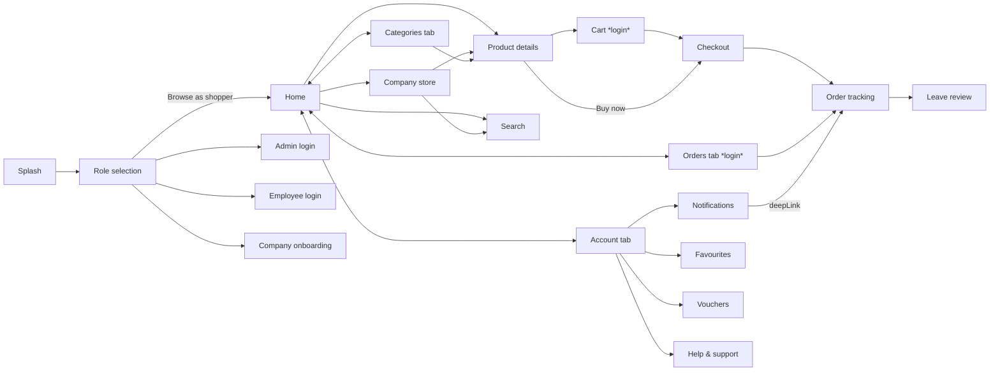
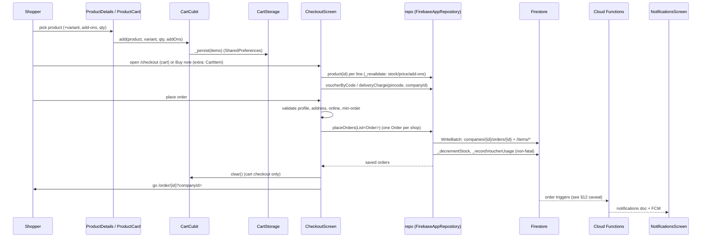
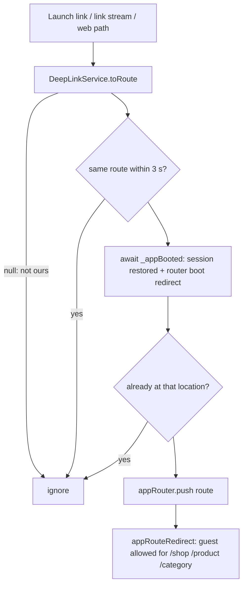

# SHOPPER_FLOW.md — Shopper application guide

Written from the source code of this repository. Every class, method, route and
collection named here exists in the code; where the code differs from what you
might expect, it says so (see **§0** and **§12**).

---

## 0. Read this first — how this project differs from a "typical" Flutter app

| You may expect | What this project actually does |
|---|---|
| `Provider` / `ChangeNotifier` / ViewModels | **`flutter_bloc` Cubits** (`AuthCubit`, `CartCubit`, `WishlistCubit`, `LocaleCubit`). The only `ChangeNotifier` is `AuthSession` (read by the router). Screens also hold local state in `StatefulWidget`s and listen to Firestore `Stream`s directly. |
| REST API, endpoints, HTTP verbs, JSON | **There is no REST API.** The backend is **Firebase**: Cloud Firestore (data), Firebase Auth (phone OTP + Google), Cloud Messaging (push), Remote Config, Cloud Functions, Realtime DB handle. The "API" is the `AppRepository` interface (`lib/core/repositories/app_repository.dart`). |
| Service/API class per feature | One repository: `AppRepository` → `FirebaseAppRepository` (real) or `MockAppRepository` (in-memory). Reached through the global getter `repo`. |
| Splash → onboarding carousel | Splash → **role selection** screen. No onboarding carousel exists. |
| Digital warranty, service requests | **Not implemented.** No code references either. |
| Online payment at checkout | **Not implemented in the shopper app.** An order is placed with `paymentStatus: pending` and an empty `paymentMethod`; payment is recorded later by the shop (admin side). |
| Push-notification tap opens a screen | **Not wired** (see §8). The in-app Notification Centre does open screens via `deepLink`. |

Implementation status legend used below: ✅ implemented · ◐ partial · ✖ not implemented.

---

## 1. Project architecture

### 1.1 Stack
Flutter (web + Android + iOS; desktop folders exist), `flutter_bloc`, `go_router`,
`firebase_core / firebase_auth / cloud_firestore / firebase_messaging /
firebase_remote_config / firebase_app_check / firebase_database`, `google_sign_in`,
`app_links` (deep links), `share_plus`, `url_launcher`, `mobile_scanner` (QR),
`shared_preferences` + `flutter_secure_storage` (local storage), `package_info_plus`.
Localisation: Flutter `gen-l10n` (English, Hindi, Gujarati).

### 1.2 Folder map (`lib/`)

```
lib/
  main.dart / main_uat.dart / main_prod.dart   entry points (flavours)
  firebase_options{,_uat,_prod}.dart           generated Firebase config
  app/
    app.dart                  MaterialApp.router, deep-link handler, gates
    routes/app_router.dart    AppRoutes constants, redirect guard, GoRouter
    theme/app_theme.dart      colours + light/dark ThemeData
    l10n/                     ARB files, generated AppLocalizations, LocaleCubit, L10n
    widgets/language_selector.dart
  core/
    config/        app_config.dart, environment.dart (UAT/PROD)
    models/        plain data classes (Product, Order, Company, AppUser …)
    repositories/  app_repository.dart  (the interface = the "API")
    database/      firebase_app_repository.dart, mock_app_repository.dart, mock_data.dart
    domain/        pure business rules (cart maths, order status, vouchers, add-ons …)
    services/      AuthSession, deep links, notifications, remote config, cart storage …
    cache/         Firestore cache, shared live queries, image cache, web cache consent
    utils/         AuthGuard, responsive helpers, formatters, share helper, force update gate
    widgets/       shared widgets (toasts, shimmer, image viewers, badges …)
  features/
    splash/ auth/ marketplace/ product/ checkout/ account/ notifications/
    reviews/ help_support/ qr/ company_onboarding/        ← shopper-facing
    admin/ employee/                                      ← other roles
```

### 1.3 Patterns used
- **Repository pattern with a service locator.** `ServiceLocator.instance.init(firebaseReady:)`
  (called from `main()`) picks `FirebaseAppRepository` or `MockAppRepository`
  (`AppConfig.useMockData` or Firebase failed to start). Screens call the top-level
  getters in `service_locator.dart`: `repo`, `connectivity`, `deepLinks`, `reports`.
- **Cubits for app-wide state**, registered once in `Bootstrap` (`main.dart`).
- **Pure domain classes** in `core/domain/` hold the rules (`CartCalculator`,
  `OrderStatusRules`, `VoucherEvaluator`, `AddOnRules`, `OrderPricer` …) so the cart,
  checkout and admin screens cannot disagree. They have unit tests in `test/domain`.
- **Streams from Firestore directly into widgets** via `StreamBuilder` /
  `ReplayStreamBuilder`; there is no per-screen ViewModel.
- **Routing** is declarative `go_router` with one global `redirect` (`appRouteRedirect`).

### 1.4 Localisation, theme, responsive
- ARB files `lib/app/l10n/app_{en,hi,gu}.arb`; `l10n.yaml` (template `app_en.arb`,
  class `AppLocalizations`, `nullable-getter: false`). Use `AppLocalizations.of(context).key`.
  Code without a `BuildContext` uses `L10n.current` (`l10n_service.dart`).
  `LocaleCubit` persists the choice in `SharedPreferences` key `preferred_language`
  (`en` default; `en`, `gu`, `hi` supported). Regenerate with `flutter gen-l10n`.
- Theme: `AppTheme.light()` / `AppTheme.dark()`; `App` forces `themeMode: ThemeMode.light`.
- Responsive: `ResponsiveContext` extension (`core/utils/responsive_extensions.dart`):
  `context.isMobile / isTablet / isDesktop / isLargeDesktop` (breakpoints in
  `AppBreakpoints`). Desktop swaps the bottom navigation for `WebHeader`.

### 1.5 Important helpers (see also §6)
`AuthGuard.runWithAuth`, `ProductShare`, `FavoriteActions`,
`showAddToCartNotification`, `showAppToast` (extension on `ScaffoldMessenger`),
`ConnectivityService`, `ReplayStreamBuilder`, `Refreshable`, `SharedStreams`.

---

## 2. Application initialisation

```mermaid
flowchart TD
  A[main_uat / main_prod: EnvironmentConfig.init] --> B[main.dart main()]
  B --> C[Firebase.initializeApp with EnvironmentConfig.firebaseOptions]
  C -->|fails| M[MOCK mode: firebaseReady=false]
  C --> D[App Check - skipped on web]
  D --> E[FirebaseMessaging.onBackgroundMessage - not web]
  E --> F[ServiceLocator.init -> repo / notification / remote config]
  M --> F
  F --> G[RemoteConfig.init with 2s timeout]
  G --> H[AppImages.init, FirestoreCache.clearIfPending, web cache consent]
  H --> I[runApp Bootstrap]
  I --> J[Cubits created: Locale, Auth, Cart, Wishlist]
  J --> K[App: MaterialApp.router + DeepLinkHandler]
  K --> L[GoRouter initialLocation '/' = SplashScreen]
```

Step by step (`lib/main.dart`):
1. `WidgetsFlutterBinding.ensureInitialized()`.
2. **Firebase init.** `Firebase.initializeApp(options: EnvironmentConfig.firebaseOptions)`
   unless `Firebase.apps` is non-empty; a `duplicate-app` error is tolerated. Flavour
   comes from `main_uat.dart` / `main_prod.dart` (they call `EnvironmentConfig.init`
   then `app.main()`); running `main.dart` directly defaults to **UAT**. Any other
   failure → `firebaseReady = false` → **mock mode**.
3. **App Check** (`_initAppCheck`) — returns immediately on web (needs reCAPTCHA);
   debug tokens/providers on Android/iOS.
4. **FCM background handler** `firebaseMessagingBackgroundHandler` registered (not on
   web). The handler body is empty (see §8).
5. `ServiceLocator.instance.init(firebaseReady:)` creates `ConnectivityService`,
   `DeepLinkService`, `ReportService`, the repository, and — only when using Firebase —
   `NotificationService` and `RemoteConfigService`. Remote Config `init()` has a 2 s timeout.
6. **Caching**: `AppImages.init()`, `FirestoreCache.clearIfPending(...)`. On web the stored
   consent (`CacheConsentStore`) is read; a `CacheConsentController` applies
   `FirestoreCache.apply(...)`. First-time web visitors see `CacheConsentPrompt` over the
   running app; nothing is kept on disk until they answer.
7. `runApp(Bootstrap)`. `_BootstrapState` creates `LocaleCubit`, `AuthCubit`, `CartCubit`,
   `WishlistCubit`, calls `_localeCubit.load()`, and listens to `AuthSession` to
   (a) bind favourites to the signed-in user, (b) on account change clear `SharedStreams`
   and `FirestoreCache.markForClearing()` so private data never leaks between accounts.
8. `App` (`app/app.dart`) builds `MaterialApp.router(routerConfig: appRouter)`, wrapped in
   `ForceUpdateGate` (Remote Config `minSupportedVersion` + `forceUpdate`), and inside the
   app `CacheConsentPrompt` and `OfflineBanner`. `_initDeepLinks()` starts `DeepLinkHandler`.
9. `AuthCubit` constructor calls `_restoreSession()` (encrypted local cache first, then
   Firebase Auth fallback; sets `AuthSession.isRestoring` until finished).
10. Router `initialLocation` is `/` → `SplashScreen`.

Local/secure storage: cart in `SharedPreferences` (`CartStorage`, key `local_cart_items_v1`);
signed-in profile cached encrypted by `SecureSessionCache` (`FlutterSecureStorage` with an
encrypted `SharedPreferences` backup, `EncryptionHelper`); language in `SharedPreferences`.

---

## 3. Shopper user flow



| Area | Status | Where |
|---|---|---|
| Splash | ✅ | `features/splash/splash_screen.dart` – waits for session restore, routes by role; 4 s safety timeout → `/role` |
| Role selection / guest entry | ✅ | `role_selection_screen.dart` – "shopper" goes straight to `/home` (browsing needs no login) |
| Onboarding carousel | ✖ | does not exist |
| Phone-OTP login & sign-up | ✅ | `auth/user_login/user_login_screen.dart`, `auth/signup/user_signup_screen.dart` |
| Google sign-in | ✅ | `AuthCubit.signInWithGoogle` (popup on web, `google_sign_in` on mobile) |
| Login prompt for guests | ✅ | `AuthGuard.runWithAuth` → `AuthBottomSheet` |
| Home | ✅ | `marketplace/home/home_screen.dart` (see §3.1) |
| Bottom/web navigation | ✅ | `marketplace/widgets/marketplace_shell.dart`, `marketplace_bottom_nav.dart`, `web_header.dart` (4 tabs: Home, Categories, Orders, Account) |
| Categories & listing | ✅ | `marketplace/categories/`, `marketplace/category_view/category_view_screen.dart` |
| Company (shop) store | ✅ | `marketplace/company_store/company_store_screen.dart` |
| Product details, variants, add-ons | ✅ | `product/details/product_details_screen.dart`, `product/widgets/add_on_sheet.dart` |
| Search & filters | ✅ | `product/search/search_screen.dart`, `core/domain/catalog.dart` (`CatalogQuery`, `Catalog.apply`) |
| Cart | ✅ | `checkout/cart/cart_screen.dart`, `cart_cubit.dart` |
| Checkout & order placement | ✅ | `checkout/payment/checkout_screen.dart` |
| Orders list, cancel, re-order | ✅ | `checkout/tracking/orders_screen.dart` |
| Order status tracking | ✅ | `checkout/tracking/order_tracking_screen.dart` (live `watchOrder` stream) |
| Favourites | ✅ | `account/liked_products_screen.dart`, `wishlist_cubit.dart`, `core/utils/favorite_actions.dart` (max 25) |
| Vouchers / deals | ✅ | home rail + sheet, `account/vouchers_screen.dart`, applied at checkout |
| Reviews & ratings | ✅ | `reviews/leave_review_screen.dart`, `reviews_screen.dart` |
| Notification centre | ✅ | `notifications/notifications_screen.dart` |
| Push-notification tap | ✖ | not wired (§8) |
| Product share & deep links | ✅ | `core/utils/product_share.dart`, `core/services/deep_link_*.dart` |
| QR scanner | ✅ | `qr/qr_scanner_screen.dart` (route `/qr-scanner`) |
| Profile, addresses, language | ✅ | `account/account_screen.dart`, `account/widgets/add_edit_address_dialog.dart` |
| Help & support | ◐ | `help_support/*` – the contact form opens a `mailto:` via `EmailService` (no ticket backend) |
| Digital warranty | ✖ | not present |
| Service requests | ✖ | not present (support email only) |
| Logout | ✅ | `AuthCubit.signOut` |

### 3.1 Home screen sections (all optional – hidden when empty)
Header/location, **ads banner carousel** (`home_ads_banners`, shop-scoped, tap follows
`actionType`: product / category / external URL / shop), Explore Categories
(`home_explore_categories`), Store Vouchers & Deals, Shops Near You, Trending Now
(`home_trending_now`, paged) and Recommendations. Data comes from `repo.adBanners(shopId:)`,
`homeExploreCategories`, `homeTrendingNow`, `vouchers`, `companies`, `recommendations`.
The shop in view is `shopId` (route query `?shopId=`) or the one the shopper picked.

### 3.2 Guest vs signed-in
Guests may browse home, categories, shops, product pages, search. The router sends a
guest to `/user-login` for **`/cart`, `/checkout`, `/orders`, `/favorites`, `/order/*`**
(`appRouteRedirect`). Individual buttons also use `AuthGuard.runWithAuth`
(it shows a toast + `AuthBottomSheet`, then resumes the action after login).

---

## 4. Order flow (end to end)



### 4.1 Selecting a product, options and availability
- `Product` (`core/models/product.dart`): `variants` (`ProductVariant` – `sku`, `title`,
  `attributes`, `stockQty`, `isUnlimitedStock`, `priceOverride`, `mrpOverride`,
  `unitValue/unitType`), `options`, `addOns` (+ `addOnSelection`), `images`, `amount`,
  `discountAmt`, `isPublished`. Selling price = `discountAmt` when > 0, else `amount`;
  variant price via `product.priceOf(variant)` / `mrpOf(variant)`.
- Product details keeps `_selectedVariantIndex` (default `p.defaultVariantIndex`).
- Availability: `ProductVariant.isInStock` (`isUnlimitedStock || stockQty > 0`) and
  `Catalog.stockStatus` (`inStock / lowStock / outOfStock / unlimited`).
- **Unpublished products are hidden from shoppers**: `repo.products()` excludes
  `isPublished == false` unless `includeUnpublished: true` (admin only); product details
  shows "Product not found" for an unpublished product.
- Add-ons are validated by `AddOnRules` (unknown / disabled / "radio" allows one).

### 4.2 Cart (`CartCubit` / `CartState`)
- State: `items: List<CartItem>`, getters `totalItems`, `totalAmount`, `byCompany`.
- `add()` builds a `CartItem.fromSelection(...)`; same `cartKey` + `companyId` merges and
  **caps quantity at `item.maxQty`** (stock). Other methods: `incrementByCartKey`,
  `decrementByCartKey`, `removeByCartKey`, `replaceItem`, `clear`, `loadFromStorage`.
- Every change calls `_persist` → `CartStorage.saveCart` (JSON in `SharedPreferences`).
- A cart can span **several shops**; checkout splits it per shop.
- Money maths lives in `CartCalculator` (`line`, `summary`): `itemTotal = (variantPrice +
  add-ons) × qty`, `subtotal = Σ itemTotal`, `discount = Σ MRP − subtotal`,
  `grand = subtotal + delivery`, everything rounded to paise (`roundMoney`).

### 4.3 Checkout (`CheckoutScreen`)
`_bootstrap()` loads addresses (`AuthSession`/`AppUser.addresses`), companies, delivery
charges, previous order count (for voucher rules) and calls `_revalidate()`.

`_revalidate(items)` re-reads each product (`repo.product`). Missing products go to
`_unavailable` and are excluded; add-ons are refreshed against the live catalogue
(`AddOnRules.refresh`), prices/stock are updated and the shopper is told what changed.

Delivery: per shop `DeliveryType.homeDelivery` or `selfPickup` (forced to pickup when the
shop `!allowsHomeDelivery`). Home delivery charge = `repo.deliveryCharge(pincode, companyId)`.
Self pickup stores a `PickupShopCard` snapshot.

Vouchers: `_applyVoucher` → `repo.voucherByCode(companyId, code)` →
`VoucherEvaluator.evaluate(...)` (see §9).

`_placeOrder(state)` – in order:
1. Cart not empty and not already placing.
2. Profile has **name and mobile** (else toast).
3. A delivery **address** is selected if any shop uses home delivery.
4. `connectivity.isOnline()` (critical write is refused offline).
5. `_revalidate`, then build `OrderBill`s (`OrderPricer`, `core/domain/order_pricing.dart`).
6. Per shop: **minimum order value** (`company.minOrderAmount`) for home delivery.
7. Build one `Order` per shop (status `pending`, payment `pending`, `paymentMethod: ''`,
   address/pincode snapshot, voucher id/code, frozen line prices).
8. `repo.placeOrders(placed)`.
9. On success: clear the cart (not for Buy-now), toast, `context.go(orderPath(id,
   companyId))` for one order or `context.go(AppRoutes.orders)` for several.

### 4.4 The "order API" – `FirebaseAppRepository.placeOrders`
There is no HTTP call. It validates (company + items present), then in **one
`WriteBatch`**: for each order a doc at `companies/{companyId}/orders/{autoId}` containing
`id, userId, customerName/Email/Phone, companyId, companyName, subtotal, discountAmount,
deliveryCharge, totalAmount, address, pincode, pickupShop?, voucherId, voucherCode,
paymentMethod, paymentStatus, orderStatus:'pending', deliveryType,
employeePackingDone:false, statusHistory:[{status:'pending', note:'Order placed',
timestamp}], stockRestored:false, createdAt, updatedAt` plus one `items/{autoId}` doc per
line (`OrderItem.toMap()`). After the commit, **non-fatal** steps run: `_decrementStock`
and `_recordVoucherUsage` (failures are logged, never block the order). Returns
`List<Order>` with the created ids. Security rules for create: `firestore.rules`
→ `companies/{id}/orders` (a shopper cannot pre-mark payment as done/verified).

### 4.5 After placing
- **Orders tab** (`OrdersScreen`) streams `repo.orders(userId:)` (private stream; never cached
  across accounts – `_forgetAccount`). Cards show status badge, ETA (`OrderEta.label` for
  packing / ready / on-the-way), **Cancel**, **Re-order**.
- **Details / tracking** (`OrderTrackingScreen`, route `/order/:id?companyId=`) uses
  `repo.watchOrder(orderId, companyId:)` – live updates; timeline from
  `OrderStatus.trackerChain` (`pending → confirmed → packing → ready → on_the_way →
  delivered → completed`). Back returns to wherever it was opened from; with nothing
  underneath (just after checkout) it goes to `/orders`.
- **Re-order** (`_reorder`): re-reads each product, re-adds with the same variant (matched by
  `variantSku`) and qty; missing products are reported.
- **Cancel**: `repo.cancelOrder(orderId, companyId:, reason:, userId:)` – customers only while
  `pending` (`OrderStatusRules.isCustomerCancellable`).
- **Status updates** are made by shop staff, not the shopper (`repo.updateOrderStatus`,
  admin/employee screens), validated by `OrderStatusRules.ensureTransition`.
- **Review → completed**: `repo.submitReview` moves a `delivered` order to `completed`.
- **Notifications**: see §8 and the caveat in §12.

---

## 5. Data access & flow (replaces "REST API" tables)

General path: **Widget → (Cubit or local state) → `repo` (AppRepository) → Firestore/Auth →
`Model.fromMap` → Stream/Future → Widget.**

### 5.1 Firestore layout (from `firebase_app_repository.dart` header)
```
/companies/{companyId}                         shop profile (+ plan/max_products set by platform)
   /admins /employees /categories /products
   /orders/{orderId}/items/{itemId}
   /vouchers /banners /delivery_charges/{pincode} /reviews /recommendations /notifications
/users/{uid}                  shopper profile, addresses, fcmTokens
/favorites/{uid}              { userId, items[] }  (max 25)
/home_explore_categories  /home_trending_now  /home_ads_banners   (shop-scoped via shopId)
/media_links  /home_screen_confing_password/password (storefront lock, admin only)
```
Legacy flat collections (`orders`, `products`, `categories`, …) are still read as fallbacks.

### 5.2 Feature → repository method → model → UI

| Feature | Repository method(s) | Model | Shown by |
|---|---|---|---|
| Shops | `companies()`, `company(id)` | `Company` | Home "Shops near you", company store |
| Categories | `categories({companyId})` | `Category` | Categories tab, category view, home rail |
| Products | `products({companyId, …})`, `product(id)` | `Product`, `ProductVariant` | home, store, search, details |
| Ads banners | `adBanners({shopId})` | `AdBanner` | `HomeScreen._adsCarousel` |
| Vouchers | `vouchers(companyId)`, `voucherByCode` | `Voucher` | home, vouchers screen, checkout |
| Delivery charge | `deliveryCharge(pincode, companyId)` | `DeliveryCharge` | checkout |
| Place order | `placeOrders(orders)` | `Order`, `OrderItem` | checkout |
| Orders | `orders({userId})`, `order(id)`, `watchOrder` | `Order` | Orders tab, tracking |
| Cancel | `cancelOrder(...)` | – | orders list / tracking |
| Reviews | `submitReview`, `orderReviews`, `productReviews`, `reviews(companyId)` | `Review` | review screens, product page |
| Notifications | `notifications(recipientId)`, `markNotificationRead(id)` | `AppNotification` | notification centre |
| Favourites | `favorites(userId)`, `addFavorite(userId, entry, replaceOldest:)` and remove (behind `WishlistCubit`) | `FavoriteEntry` (`FavoriteLimitReached` when full) | favourites screen |
| Auth | `sendOtp`, `verifyOtp`, `userExists`, `createUserAccount`, `signOut`, `saveUserAddress`, … | `AppUser`, `AddressEntry` | login/sign-up/account |
| Push token | `registerFcmToken(userId, token)` | – | `NotificationService.init` |

### 5.3 Loading / empty / error handling
- Streams: `StreamBuilder` with `ConnectionState.waiting && !hasData` → shimmer skeletons
  (`modern_shimmer.dart`); empty list → an explicit empty state (or the section hides).
- `ReplayStreamBuilder` shows the last value at once on revisit.
- Writes catch errors and show a toast/inline message; checkout also checks connectivity.
- `OfflineBanner` (global) shows connectivity loss; Firestore's on-device cache keeps reads working.
- Shared public queries go through `SharedStreams` (one listener per query, keep-alive,
  max-age); **private** streams (orders, favourites, notifications) are never shared.

---

## 6. Helper classes and reusable components

| File | What it does | Kind |
|---|---|---|
| `core/services/service_locator.dart` | builds repo & services; `repo`, `connectivity`, `deepLinks`, `reports` getters | singleton |
| `core/services/auth_session.dart` | `currentUser`, `isRestoring`, `hasCompletedInitialBoot`, active delivery address; `ChangeNotifier` the router listens to | static singleton |
| `core/utils/auth_guard.dart` | `AuthGuard.runWithAuth(context, onAuthenticated:, message:, requireAddress:)` – gate an action behind login and resume it | static utility |
| `core/services/cart_storage.dart` | save/load cart JSON | helper |
| `core/domain/cart_calculator.dart`, `order_pricing.dart` | all money maths, `OrderBill`, `roundMoney` | pure domain |
| `core/domain/order_status.dart` | `OrderStatus`, `PaymentStatus`, `PaymentMethod`, `OrderStatusRules` | pure domain |
| `core/domain/voucher_evaluator.dart` | voucher rules → `VoucherEvaluation` | pure domain |
| `core/domain/addon_rules.dart`, `catalog.dart`, `shop_hours.dart`, `order_eta.dart` | add-on rules, search/sort/stock, opening hours, ETA text | pure domain |
| `core/domain/validators.dart` | form validation helpers | pure |
| `core/utils/product_share.dart` | `ProductShare.linkFor/messageFor/share` (same URL as the admin QR); `sharer` override for tests; clipboard fallback | static utility |
| `core/services/qr_deep_link_service.dart` | builds `https://<domain>/shop/<id>[/product/<id>]` and `ecommerce://shop/…` URLs | static |
| `core/services/deep_link_service.dart` | `toRoute(Uri)` – turns links into router locations | service |
| `core/services/deep_link_handler.dart` | start-up + stream handling, dedupe, waits for boot | per-app instance |
| `core/utils/favorite_actions.dart` | like/unlike with login guard and "replace oldest when full" dialog | static |
| `core/utils/cart_notification.dart` | `showAddToCartNotification` toast with "view cart" | function |
| `core/widgets/app_toast.dart` | `ScaffoldMessenger.showAppToast` | extension |
| `core/widgets/replay_stream_builder.dart`, `core/cache/refreshable.dart`, `shared_streams.dart` | stream/refresh caching | utilities |
| `core/utils/responsive_extensions.dart` | `isMobile/isTablet/isDesktop` | extension |
| `core/utils/formatters.dart`, `type_utils.dart` | currency/date formatting, safe parsing | utilities |
| `core/services/connectivity_service.dart` | `isOnline()` | service |
| `core/services/secure_session_cache.dart`, `encryption_helper.dart` | encrypted profile cache | helper |
| `core/utils/force_update_gate.dart`, `remote_config_service.dart` | blocking update screen | widget/service |
| `core/utils/app_route_logger.dart` | `NavigatorObserver` logging routes | observer |

---

## 7. State management

- **Registration** (`main.dart` → `Bootstrap`): one instance of each cubit, passed to `App`
  as `BlocProvider.value`. Access with `context.read<T>()`, `context.watch<T>()`,
  `BlocBuilder/BlocListener`.
- **`AuthCubit`** (`features/auth/auth_cubit.dart`) – `AuthState{status, user, error,
  restoring}`; `AuthStatus` = unauthenticated / authenticating / authenticated / error.
  Methods: `sendOtp`, `verifyOtp`, `signInWithGoogle`, `adminLogin`, `employeeLogin`,
  `createUserAccount`, `saveUserAddress`, `deleteUserAddress`, `setDefaultAddress`,
  `selectActiveAddress`, `updateUserMobile`, `signOut`. It **mirrors the user into
  `AuthSession.set(...)`** so `GoRouter.refreshListenable` re-runs the redirect.
- **`CartCubit`** – §4.2; `loadFromStorage()` restores on start.
- **`WishlistCubit`** – favourites, `bindUser(userId)` follows the session; cap
  `maxFavoriteProducts = 25` (`core/models/favorite.dart`).
- **`LocaleCubit`** – language.
- **Screen-local state**: most screens are `StatefulWidget`s that open streams once in
  `initState`/`late final` and rebuild with `StreamBuilder`.
- **Loading / success / empty / error**: no shared "ViewState" type; each screen models it
  with `ConnectionState`, `snap.hasData`, nullable results and `_loading/_placing` flags.
- **Disposal/refresh**: cubits live for the app lifetime; screens dispose controllers;
  `SharedStreams` closes idle listeners after a keep-alive; account change clears shared
  queries (`Bootstrap._onAccountChanged`).

---

## 8. Navigation, notifications, deep links

### 8.1 Routes (`AppRoutes` in `app/routes/app_router.dart`) – shopper subset
`/` splash · `/role` · `/user-login` · `/user-signup` · **shell tabs** `/home`, `/categories`,
`/orders`, `/account` (`StatefulShellRoute.indexedStack` – each tab keeps its state) ·
`/company/:slug` · `/shop/:shopId` · `/shop/:shopId/category/:categoryId` ·
`/shop/:shopId/product/:productId` · `/category/:id` · `/product/:id` · `/search` ·
`/cart` · `/checkout` (extra: `CartItem` or `List<CartItem>` for Buy-now) ·
`/order/:id?companyId=` · `/reviews/:companyId` · `/leave-review/:orderId?companyId=&productId=&rating=` ·
`/notifications` · `/favorites` · `/vouchers` · `/help-support` · `/contact-support` · `/qr-scanner`.

**Guard (`appRouteRedirect`)**: holds while the session restores; on first boot a guest may
only land on an allow-list (home, search, cart, login screens, `/company/`, `/shop/`,
`/product/`, `/category/`, `/reviews/`) else is sent to `/home`; a signed-in user is sent to
their role's home (`/admin`, orders pipeline for employees, `/home`); guests are redirected
to `/user-login` for cart/checkout/orders/favourites/order pages; admin/employee areas are
role-protected.

**`go` vs `push`**: use `push` for "open on top, back returns" (notifications, product,
order details from a list). `go` replaces the stack (tabs, post-checkout). Note
`OrderTrackingScreen` and `NotificationsScreen` back handling: `pop` if possible,
otherwise `go` to `/orders` / `/home`.

### 8.2 Notifications
- **Registration**: after sign-in `AuthCubit._registerPush` → `NotificationService.init(userId)`
  → `requestPermission`, `getToken`, `repo.registerFcmToken`, and on token refresh.
- **In-app Notification Centre** ✅: `repo.notifications(userId)` is a
  `collectionGroup('notifications')` query by `recipientId`, newest first. Tapping an item
  calls `markNotificationRead(id)` and, if `deepLink` is set, converts it with
  `deepLinks.toRoute(Uri.parse(deepLink))` and **pushes** that route (e.g.
  `ecommerce://order/<id>` → `/order/<id>`).
- **Foreground / background / terminated push taps** ✖: `NotificationService` exposes
  `onMessage` and `onMessageOpenedApp` streams, but **nothing subscribes to them**, there is
  no `getInitialMessage()` call, and `firebaseMessagingBackgroundHandler` is empty. A push
  shows via the OS tray only; tapping it opens the app but does not navigate.

### 8.3 Deep links
URL forms (`QrDeepLinkService`): `https://<publicDomain>/shop/<shopId>`,
`…/shop/<shopId>/category/<id>`, `…/shop/<shopId>/product/<id>`, plus
`ecommerce://shop/…` and `ecommerce://order/<id>` (used by notifications). Public domains:
`myshop-8bd4d.web.app` (UAT), `myshop-prod.web.app` (PROD) – from `EnvironmentConfig.publicDomain`.
Android intent filters: scheme `ecommerce` and https hosts above with `pathPrefix=/shop`
(`AndroidManifest.xml`); iOS registers the `ecommerce` scheme (`Info.plist`). iOS universal
links need Associated Domains, which are **not set up** (◐).

Flow (`DeepLinkHandler`):

`toRoute` handles the `ecommerce://` scheme, `#/` hash routes on web, and plain web paths for
recognised prefixes; `/shop/<id>/product` with no id falls back to `/shop/<id>`.
**Auth**: product/category/shop links are public; `/order/*` links send a guest to login (the
original link is not resumed after login).

---

## 9. Business rules (where they live)

- **Availability**: variant/product stock (`isInStock`, `Catalog.stockStatus`); unlimited stock
  flag; unpublished products hidden from shoppers; cart quantity capped by `maxQty`; checkout
  drops products that disappeared and refreshes prices (`_revalidate`).
- **Product options/variants**: price/MRP overrides per variant; add-on rules in `AddOnRules`
  (disabled/unknown add-ons dropped, radio-style single choice, price refresh).
- **Cart/price**: §4.2; money rounded to paise; the same `CartCalculator` is used by cart,
  checkout and direct-buy so numbers match.
- **Minimum order**: home delivery requires `subtotal ≥ company.minOrderAmount`.
- **Delivery**: per-shop `allowsHomeDelivery`; charge looked up by pincode in
  `companies/{id}/delivery_charges/{pincode}` (legacy flat fallback); self pickup = no charge.
- **Vouchers** (`VoucherEvaluator`): rejection reasons `notFound, inactive, expired,
  minOrderNotMet, scopeMismatch, perUserLimitReached, …`; scope = all / specific product /
  specific category; per-user limit; usage recorded after the order commit (non-fatal).
- **Order status machine** (`OrderStatusRules.transitions`):
  ```mermaid
  stateDiagram-v2
    [*] --> pending
    pending --> confirmed
    pending --> cancelled
    confirmed --> packing
    confirmed --> cancelled
    packing --> ready
    packing --> cancelled
    ready --> on_the_way
    ready --> cancelled
    on_the_way --> delivered
    delivered --> completed: customer review
    completed --> [*]
    cancelled --> [*]
  ```
  Shopper cancellation only from `pending`. Firestore rules additionally restrict what a
  customer may change on their own order (cancel from pending; delivered→completed with a review).
- **Reviews**: allowed only for your own order once `delivered` or `completed`; rating 1–5;
  one review per `(orderId, productId)` (`Review.idFor`), editable; admin can hide; first
  review completes the order.
- **Favourites**: max 25; liking more offers to replace the oldest (`FavoriteActions`).
- **Authentication/permissions**: guests browse only; cart/checkout/orders need login; roles
  `admin`/`employee`/`user` decide router access (`AuthSession.isAdmin/isEmployee`).
- **Shop hours**: `shop_hours.dart` (`00:00–00:00` = open all day; closing before opening =
  overnight).
- **Warranty / service requests**: ✖ no rules exist.
- **Plans/limits (admin side)**: product limits and plan tiers (`subscription_plans.dart`,
  `product_limits.dart`) affect which products exist, not shopper behaviour.

---

## 10. Developer guide

**Add a screen** – create `features/<area>/<name>_screen.dart`; add a constant to `AppRoutes`;
add a `GoRoute` in `appRouter` (put it inside `StatefulShellRoute` only if it is a tab); if
it needs login add it to the guest-redirect list in `appRouteRedirect` and/or use
`AuthGuard.runWithAuth`; add the route to the boot allow-list only if guests may deep-link to it.

**Add data access (the "API")** –
1. Model: `core/models/<x>.dart` with `fromMap(String id, Map)` / `toMap()`.
2. Interface: add the method to `AppRepository`.
3. Real implementation in `FirebaseAppRepository` (use the `_xxxCol(companyId)` helpers; shared
   public reads through `_shared.stream(key, DataClass.reference, …)`; private reads not shared).
4. Mock implementation in `MockAppRepository` (tests and offline mode depend on it).
5. Firestore rules in `firestore.rules` (+ a case in `firestore_rules_test/`).
6. Use it from the UI through `repo`.

**Add state** – an app-wide concern → a Cubit registered in `Bootstrap` (`main.dart`), provided
in `App(providers:)`. A single screen's data → local `StatefulWidget` state + `StreamBuilder`.
Put rules in `core/domain/` as pure functions/classes and unit-test them.

**Connect API → UI** – `late final Stream<List<X>> _x = repo.xs(...)` in the state class, then
`StreamBuilder` with a skeleton for `waiting && !hasData`, an empty state, and the list.

**Navigation** – `context.push(AppRoutes.x)` / `context.push(AppRoutes.xPath(id))` for
drill-down; `context.go` only to reset the stack. Give detail screens a back handler: `pop` if
`context.canPop()` else `go` to a sensible parent.

**Localisation** – add the key to `app_en.arb` (with `@key` placeholders), then the same key to
`app_hi.arb` and `app_gu.arb`, run `flutter gen-l10n`, use `AppLocalizations.of(context).key`.

**Reuse** – toasts `showAppToast`; login gate `AuthGuard`; product tiles `ProductCard`;
loading `modern_shimmer`; images `AppProductImage`/`CategoryImage`; responsive `context.isDesktop`.

**Tests** – `test/helpers/test_harness.dart` provides `TestHarness.useMockRepository()`,
`signIn`, `buildTestApp`/`pumpTestApp` (with a stub router, `extraRoutes`), platform-channel
mocks. Screens animating forever (home, save spinner) need fixed `pump(duration)` rather than
`pumpAndSettle`. Run: `flutter test`, `flutter analyze`.

---

## 11. Important files reference

**Initialisation** – `lib/main.dart` (boot, `Bootstrap`), `main_uat.dart`/`main_prod.dart`
(flavours), `core/config/environment.dart` (+ `app_config.dart`), `app/app.dart`,
`core/services/service_locator.dart`, `core/services/remote_config_service.dart`,
`core/utils/force_update_gate.dart`.

**Authentication** – `features/auth/auth_cubit.dart`, `auth/user_login/`, `auth/signup/`,
`auth/widgets/auth_bottom_sheet.dart`, `core/services/auth_session.dart`,
`core/services/secure_session_cache.dart`, `core/utils/auth_guard.dart`,
`features/splash/{splash,role_selection}_screen.dart`.

**Home & navigation** – `app/routes/app_router.dart`, `marketplace/widgets/{marketplace_shell,
marketplace_bottom_nav,web_header}.dart`, `marketplace/home/home_screen.dart`.

**Products & categories** – `marketplace/categories/`, `marketplace/category_view/`,
`marketplace/company_store/`, `product/details/product_details_screen.dart`,
`product/search/search_screen.dart`, `product/widgets/add_on_sheet.dart`,
`marketplace/widgets/product_card.dart`, `core/models/{product,category,product_addon}.dart`,
`core/domain/{catalog,addon_rules,category_tree}.dart`.

**Cart & checkout** – `checkout/cart/{cart_cubit,cart_screen,wishlist_cubit}.dart`,
`checkout/payment/checkout_screen.dart`, `core/models/cart_item.dart`,
`core/domain/{cart_calculator,order_pricing,voucher_evaluator}.dart`, `core/services/cart_storage.dart`.

**Orders** – `checkout/tracking/{orders_screen,order_tracking_screen}.dart`,
`core/models/order.dart`, `core/domain/{order_status,order_eta}.dart`,
`core/widgets/order_status_badge.dart`, `reviews/`.

**Notifications** – `notifications/notifications_screen.dart`, `core/services/notification_service.dart`,
`core/models/notification.dart`, `functions/index.js`.

**Deep links** – `core/services/{deep_link_service,deep_link_handler,qr_deep_link_service}.dart`,
`core/utils/product_share.dart`, `qr/qr_scanner_screen.dart`, `android/app/src/main/AndroidManifest.xml`,
`ios/Runner/Info.plist`, `firebase.json` (hosting rewrites).

**User profile** – `account/account_screen.dart`, `account/account_stat_cards.dart`,
`account/widgets/add_edit_address_dialog.dart`, `account/liked_products_screen.dart`,
`account/vouchers_screen.dart`, `core/models/{app_user,favorite}.dart` (`FavoriteEntry`), `help_support/`.

**Helpers & utilities** – `core/utils/*`, `core/widgets/*`, `core/cache/*`.

**Data layer** – `core/repositories/app_repository.dart` (interface),
`core/database/firebase_app_repository.dart`, `mock_app_repository.dart`, `mock_data.dart`,
`firestore.rules`, `firestore.indexes.json`, `functions/index.js`.

**Localisation & theme** – `app/l10n/*.arb`, `l10n.yaml`, `app/l10n/{locale_cubit,l10n_service}.dart`,
`app/theme/app_theme.dart`, `app/widgets/language_selector.dart`.

**Tests** – `test/helpers/test_harness.dart`, `test/features/`, `test/domain/`, `test/repository/`.

---

## 12. Known gaps and risks (found while reading the code)

1. **Push-notification taps are not handled** (§8.2): no listener on `onMessage` /
   `onMessageOpenedApp`, no `getInitialMessage`, empty background handler.
2. **Order notification Cloud Functions may not fire.** `onOrderUpdate` / `onOrderCreated` in
   `functions/index.js` are bound to the **root** path `orders/{orderId}`, but the app writes
   orders to `companies/{companyId}/orders/{orderId}`. Also its `ORDER_CHAIN` omits
   `delivered`. As written, status-change notifications/FCM for current orders depend on
   triggers that do not match the write path. (Read from source; not verified in a deployment.)
3. **No payment capture in the shopper app**; `paymentMethod` stays empty until staff record it.
4. **Dev OTP fallback**: `FirebaseAppRepository.sendOtp` sets a dev OTP `123456` when phone
   auth fails, and `verifyOtp` accepts `123456` / `000000` in those paths (including after a
   web confirmation error) with an anonymous sign-in – there is no environment guard.
   Treat as a security risk for PROD.
5. **Stock decrement and voucher usage are client-side, post-commit, non-fatal** – a failure
   leaves stock unchanged; concurrent orders can oversell.
6. **iOS universal links** are not configured (custom scheme only).
7. **Deep link to `/order/*` for a guest** does not resume after login.
8. **Warranty, service requests, onboarding carousel** do not exist.
9. **Support email** target is a hard-coded address in `EmailService.supportTargetEmail`.
